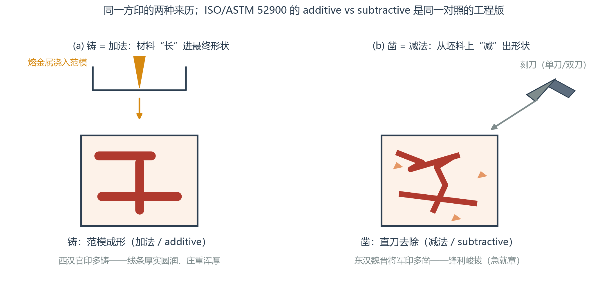
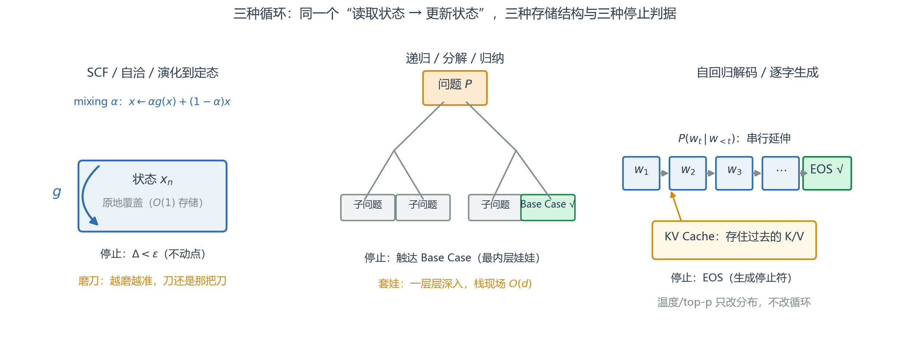
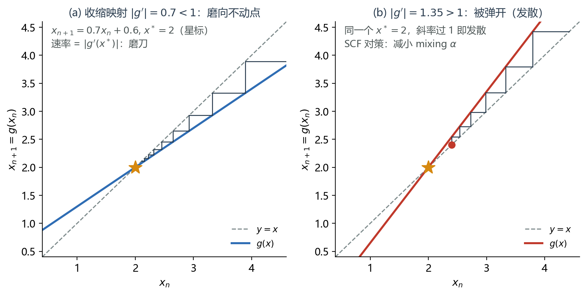
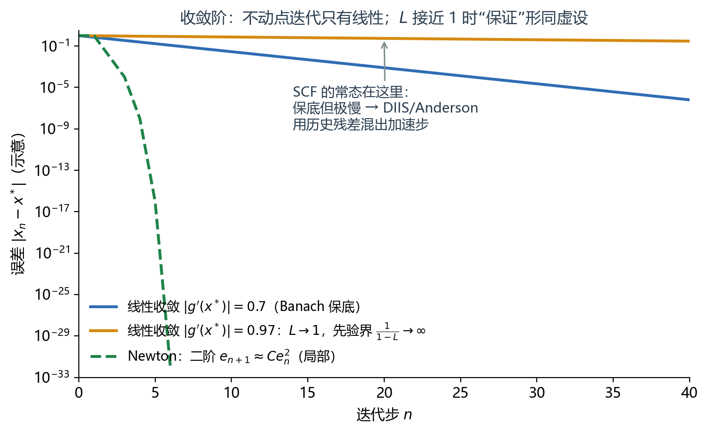
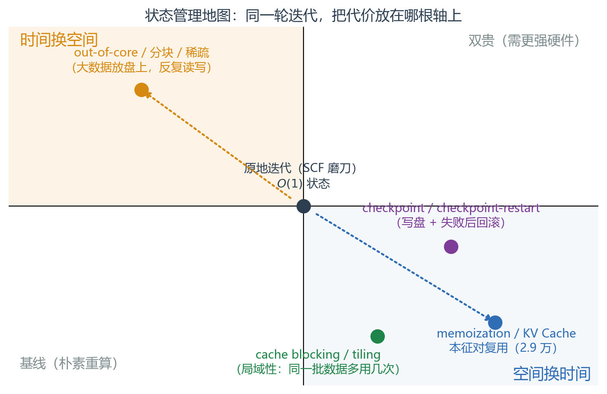

# 图案途径（Chisel–Cast）

> **定位**：这是 [26-03-21-Chisel-Cast](26-03-21-Chisel-Cast.md) 的完整版。原笔记用篆刻的"凿、铸"起兴，把递归/迭代/自洽/解码 four 个循环物种放进同一张地图；本文补齐史实与定理（均已线上核实，见文末），并把"状态管理三换"落到自己项目的真实代码上。跨域类比的物理侧应用见 [26-11-08-plasmon-v02](26-11-08-plasmon-v02.md)，方法论底座见 [26-11-08-equation-origin-v01](26-11-08-equation-origin-v01.md)。

> 篆刻是一种书法和镌刻（包括**凿、铸**）结合，来制作印章的传统艺术形式，因古代印章多采用篆书入印而得名。（通行定义，与国内课程教材口径一致）

史实核查（据百度百科"汉官印"、篆刻科普与鉴藏材料综合）：**铸印**以范模浇铜成形，西汉官印多铸，线条**厚实圆润、庄重浑厚**（罗福颐："西汉官印文字多半整齐端重，出铸造者较多"）；**凿印**以刻刀直取印坯，东汉至魏晋南北朝官印多凿，尤以**将军印**为甚——军务急促、即刻凿就，故称"急就章"，线条**锋利峻拔、锋芒毕显**，且错落天然（将军印称"章"不称"印"，多为白文）。两汉之分是倾向而非铁律。这组对照正是工程学里 **additive vs subtractive manufacturing** 的原型——ISO/ASTM 52900 对 additive manufacturing 的定义中就明确以 subtractive（传统切削加工）为对照面。

---

## 0. 一句话与全景

> 任何高性能的迭代过程，本质上都是在管理**状态（State）的存储与更新**。

四种循环物种共用同一个骨架——**读取状态 → 更新状态**——差别只在三处：驱动力、目标、以及把状态放在哪里：

| 循环物种 | 驱动力 | 目标 | 停止判据 | 状态存储 | 隐喻 |
|---|---|---|---|---|---|
| 自洽 / 不动点（SCF） | $x_{n+1}=g(x_n)$：算符/泛函把状态推回自身 | 不动点 $x^*$（稳定态） | $\Delta<\epsilon$ | 原地覆盖，$O(1)$ | 磨刀 |
| 递归分解 | 把问题 $P$ 拆成子问题 | Base Case | 触达 base case | 栈现场，$O(d)$ | 套娃 |
| 演化步进（ODE/PDE） | 算符/导数 $f'(x)$ | 推进到预设时刻 | $t=T$ | 原地推进 $O(1)$ | 行路 |
| 自回归解码 | $P(w_t\mid w_{<t})$ | 逻辑连贯的序列 | EOS | KV Cache，$O(T)$ | 串行延伸 |

---

## 1. 减法与加法：递归是凿，迭代是铸

- **递归是"自上而下"的分解**：把大问题凿开，直到最内层娃娃（Base Case）——先减后加（回溯时合并）。
- **迭代是"自下而上"的累积**：从 base case 开始一层层铸上去——动态规划的语言叫 **top-down memoization vs bottom-up tabulation**（CLRS 标准对照）：同一棵子问题树，一个先凿后记，一个自底向上直接铸表。
- **任何递归理论上都可改写为迭代**（显式维护一个栈），反之亦然。SICP §1.2.1 区分的正是"递归**过程**（deferred operations，栈增长）"与"迭代**过程**（固定大小状态）"；尾递归可被编译器当 jump 处理（Steele 1977，*LAMBDA: The Ultimate GOTO*），退化成 $O(1)$ 空间的循环——但这是**表达能力等价，不是自动效率等价**：CPython 没有 TCO，深度递归照样爆栈。
- 格点/第一性原理计算里几乎总是选迭代：物理系统的状态量巨大，栈现场（每层保留完整中间态）经不起堆。

| 维度 | 自洽数值迭代 | 编程递归 |
| --- | ---- | --- |
| 形象 | 磨刀（越磨越准，刀还是那把刀） | 俄罗斯套娃（一层套一层） |
| 状态存储 | 覆盖旧值 | 保存所有中间层现场 |
| 核心目标 | 逼近不动点（Convergence） | 完成任务分解（Decomposition） |
| 停止信号 | $\Delta<\epsilon$ | 触达 Base Case |

---

## 2. 磨刀的数学：不动点与收缩映射

自洽迭代 $x_{n+1}=g(x_n)$ 的全部理论浓缩在 **Banach 不动点定理**（1922，博士论文）：完备度量空间上的**收缩映射**（$d(g(x),g(y))\le L\,d(x,y)$，$L<1$）有唯一不动点，任何初值都收敛，且

$$|x_n-x^*|\ \le\ \frac{L^n}{1-L}\,|x_1-x_0|\qquad\text{（先验界）}；\qquad |x_n-x^*|\ \le\ \frac{L}{1-L}\,|x_n-x_{n-1}|\quad\text{（后验界）}$$

渐近误差 $e_{n+1}\approx|g'(x^*)|\,e_n$：**收敛只有线性阶，速率就是 $|g'(x^*)|$**。

⚠ **$L\to1^-$ 陷阱**：先验界分母 $1-L$ 爆炸——"保证收敛"完全没说收敛**多快**。这恰是 SCF 的常态：斜率贴着 1，磨一万刀也不准。

**历史脉络**（均已核实）：Picard 逐次逼近法（1890，*J. de math. pures et appl.*——注意不是 École Polytechnique）→ Carl Neumann 的算术平均法/Neumann 级数（1870 通信 + 1877 Teubner 专著）→ Banach 1922 抽象化 → Newton 法是另一物种：**二阶收敛** $e_{n+1}\approx\left|\frac{f''}{2f'}\right|e_n^2$，但只在单根附近局部成立（Ortega–Rheinboldt 1970）。

---

## 3. SCF：物理学家磨了快一百年的刀

**自洽场**的循环（Hartree 1928，Proc. Camb. Phil. Soc. 24, 89–110；矩阵形式 Roothaan 1951，Rev. Mod. Phys. 23, 69）：密度 → 有效势 → 波函数 → 新密度，直到密度不再变化。判据实践：Szabo–Ostlund 的经典程序用 $\Delta E<10^{-6}$ hartree，现代代码再加密度矩阵 RMS 变化 $10^{-6}\sim10^{-8}$。

**自己代码里的同款**：`Projects\转角石墨烯\...\tbg_relaxed.py` 的弛豫循环就是这个结构——mixing 参数 $\alpha=0.4$ 的欠弛豫 $u\leftarrow\alpha u_{\rm new}+(1-\alpha)u_{\rm old}$，收敛判据 $\max(\text{diff}_m,\text{diff}_f,\text{diff}_u)<\epsilon$，发散时 `alpha *= 0.5` 自适应减步长——正是 cobweb 图 (b) 里"被弹开就减小斜率"的工程版。

**加速 = 用历史残差混出更好的步**：**DIIS**（Pulay, Chem. Phys. Lett. 73, 393 (1980)）与 **Anderson acceleration**（J. ACM 12, 547 (1965)）数学上等价——同一算法在量子化学与积分方程两个社区各自独立发明。⚠ 常见误引：Pulay 1969（Mol. Phys. 17, 197）是**解析梯度**论文，不是 DIIS。层级结构：外层自洽循环（不动点，可 DIIS 加速）套内层线性求解（大规模稀疏用 Krylov，CG/GMRES）——SCF 不因 DIIS 变成 Newton 二阶，两者是不同物种。

**停止判据的工程学问**（自己的教训，见 `lessons-learned-ledger`）：
- **SCI-001**：把收敛拆到**观测量和参数轴**上——任何关键失败门都要能阻止下游结论；
- **SCI-005**：相对收敛可能完全看不见**绝对归一化错误**——要留独立锚点（DOS 总态数、filling round-trip）；
- 曾有"统一 1% 收敛判据"被 ADR 撤销：峰高这类观测量依赖展宽/网格/线型，根本不该当判据（`20261008-数值仿真证据层级` 的四层 V&V 框架把**迭代误差**与**离散化误差**分开核验）。

---

## 4. 行路的循环：演化步进

ODE/PDE 步进的驱动力是**算符/导数**，目标是**演化**而非不动点——停止判据是**到达预设时刻 $T$**，与收敛无关。同一"读状态→写状态"骨架，但它磨的不是刀，是赶路。微扰论在此登场：把无法一步到位的全局问题拆成"基于现状、微调一步"的重复劳动——这正是 Picard 逐次逼近的精神（【时间换空间】：用多轮小步换掉一次不可能的大步）。

---

## 5. 串行延伸：LLM 解码是第三种循环

自回归解码 $P(w_1\cdots w_T)=\prod_t P(w_t\mid w_{<t})$（Vaswani et al., NIPS 2017——注意会议当年还叫 NIPS；GPT-1 的 Radford et al. 2018 是未刊技术报告，勿编造出处）：

- **驱动力**：概率分布；**目标**：延伸逻辑连贯的序列；**停止**：生成 EOS；
- **温度/top-p 只重塑分布，不改循环结构**——磨刀/套娃/行路之外的第四物种：**序列的铸**，每步把一个 token 铸接到尾部；
- **KV Cache**：把过去每步的 K/V 存住避免重算——**这就是 memoization 在注意力层的化身**（无单一起源论文，属 ~2018 年起的通行实践；内存随序列长度线性增长的定量分析见 Pope et al., MLSys 2023, arXiv:2211.05102）。【空间换时间】的教科书案例。

---

## 6. 状态管理：三种换法（性能经济学）

把上面所有物种放在同一张地图上，工程决策就是"代价放在哪根轴"：

| 换法 | 付出 | 换来 | 实例 |
|---|---|---|---|
| 空间换时间 | 内存/显存/盘 | 免重算 | memoization（Michie, Nature 218, 19 (1968)）、KV Cache、**本征对复用**（research-topic-a：复用 2.9 万个边缘本征对，新增求解 0）、k 点索引缓存 |
| 时间换空间 | 计算/IO | 内存有界 | out-of-core、分块计算、稀疏矩阵、朴素重算 |
| 时间换安全 | 写盘 + 回滚时间 | 故障后不重来 | checkpoint/restart——项目里"主 checkpoint + 缓存适配器"的实践（另有 `moire-checkpoint-SKILL` 模板） |
| 局域性 | 略增存储 | 时间 | cache blocking / loop tiling：让同一批数据在缓存里多用几次（Hennessy & Patterson 记忆层级章节） |

状态的系统观：SICP 第 3 章 *Modularity, Objects, and State* 是 CS 侧的经典锚点；数据库侧的孪生兄弟是 WAL（先记日志再改状态，崩溃后可重放——Gray & Reuter《Transaction Processing》）。微扰论的缓存（把低阶结果存成高阶的输入）、SCF 的密度混合、LLM 的 KV cache，是同一枚硬币的三种面值。

⚠ 换法方向别写反：memoization/checkpoint 是**空间换时间**（多存少算），out-of-core/分块稀疏是**时间换空间**（多算少存）——原笔记的箭头在此校正。

---

## 7. 边界与反例：什么时候别磨刀

- **结构存在时别用通用迭代**：单根附近 Newton 是二阶；大规模稀疏线性问题的内层解用 Krylov。"先磨刀再谈加速"与"有近路先走近路"不矛盾——分层才是常态。
- **表达能力等价 ≠ 效率等价**：递归↔迭代可互写，但栈、TCO、缓存友好性决定了工程上限。
- **停止判据不是装饰**：$\Delta<\epsilon$ 的 $\epsilon$ 定错（统一 1% 的教训），磨得再圆的刀也会把错误磨进结论。

一句话总结：**自洽迭代是"原地踏步并修正"，递归是"套娃式深入并回溯"，解码是"串行铸接并知止"**——而高性能，就是把每一步的状态存取安排妥当。

---

## 8. 术语速查表（中英对照）

| English | 中文 | 一句话 |
|---|---|---|
| fixed point | 不动点 | $x^*=g(x^*)$，循环的归宿 |
| contraction mapping | 收缩映射 | $L<1$ 的压缩，Banach 定理的前提 |
| linear/quadratic convergence | 线性/二阶收敛 | $e_{n+1}\approx Le_n$ / $e_{n+1}\approx Ce_n^2$ |
| self-consistent field (SCF) | 自洽场 | 密度-势-波函数的自洽循环 |
| mixing / damping | 混合 / 欠弛豫 | $x\leftarrow\alpha g(x)+(1-\alpha)x$，发散救急 |
| DIIS | 直接迭代子空间反演 | Pulay 1980；用历史残差的加速 |
| Anderson acceleration | Anderson 加速 | Anderson 1965；与 DIIS 等价 |
| Krylov method | Krylov 方法 | 内层线性解（CG/GMRES） |
| recursion / iteration | 递归 / 迭代 | 分解回溯 / 原地更新 |
| tail call | 尾调用 | 编译成 jump 即 $O(1)$ 栈 |
| memoization | 记忆化 | 存结果免重算（Michie 1968） |
| dynamic programming | 动态规划 | Bellman 1957；top-down vs bottom-up |
| autoregressive decoding | 自回归解码 | $P(w_t\mid w_{<t})$ 逐 token 生成 |
| EOS token | 结束符 | 解码循环的停止判据 |
| KV cache | KV 缓存 | 注意力历史的 memoization |
| checkpoint / restart | 检查点 / 重启 | 写盘换故障安全 |
| cache blocking / tiling | 缓存分块 | 局域性换时间 |
| out-of-core | 核外计算 | 数据放盘上，时间换空间 |
| residual | 残差 | 收敛监测的对象 |
| 刻印/铸印 | 凿印 / 铸印 | 减法成形 / 加法成形，线条峻拔 / 圆润 |
| 急就章 | 急就章 | 将军印：仓促凿就的"军令实时系统" |

---

## 9. 参考资料（已核实）

- S. Banach, *Fundamenta Mathematicae* **3**, 133–181 (1922)（不动点定理原始文献）
- É. Picard, *J. de math. pures et appl.* (4) **6**, 145–210 (1890)（逐次逼近；非 École Polytechnique）
- C. Neumann, *Berichte … KGSAW Leipzig* **22** (1870)；*Untersuchungen über das logarithmische und Newton'sche Potential*, Teubner (1877)
- J. M. Ortega & W. C. Rheinboldt, *Iterative Solution of Nonlinear Equations in Several Variables*, Academic Press (1970)（收敛阶理论）
- D. R. Hartree, *Proc. Cambridge Philos. Soc.* **24**, 89–110 (1928)（Part II 为 111–132，勿合并）
- C. C. J. Roothaan, *Rev. Mod. Phys.* **23**, 69 (1951)（Hall 独立同期）
- P. Pulay, *Chem. Phys. Lett.* **73**, 393 (1980)（DIIS）；D. G. Anderson, *J. ACM* **12**, 547 (1965)（等价加速）
- A. Szabo & N. S. Ostlund, *Modern Quantum Chemistry*（SCF 判据实践，Appendix C）
- H. Abelson & G. J. Sussman, *SICP*, MIT Press（§1.2.1 过程分类；第 3 章状态）(2nd ed. 1996)
- G. L. Steele Jr., *ACM '77*, 153–162 (1977)（LAMBDA: The Ultimate GOTO）
- D. Michie, *Nature* **218**, 19 (1968)（memo functions）
- R. Bellman, *Dynamic Programming*, Princeton UP (1957)；*Eye of the Hurricane*, World Scientific (1984), p. 159（命名轶事）
- A. Vaswani et al., NIPS 2017（arXiv:1706.03762）；A. Radford et al., OpenAI 技术报告 (2018)；R. Pope et al., MLSys 2023（arXiv:2211.05102，KV Cache 内存分析）
- J. Hennessy & D. Patterson, *Computer Architecture: A Quantitative Approach*（记忆层级/blocking）
- ISO/ASTM 52900（additive vs subtractive manufacturing 定义）

**自己笔记的脉络**：[26-03-21-Chisel-Cast](26-03-21-Chisel-Cast.md)（原始速记，本文扩写）→ `Notes\QuMaMathPhys_md\eqn\Neu.md`（von Neumann 方程——密度矩阵运动方程推导 Kubo，"自洽"的量子层）→ `Notes\QuMaMathPhys_md\eqn\nonhomo.md`（Green 函数：另一枚"算符-状态"硬币）→ [26-11-08-equation-origin-v01](26-11-08-equation-origin-v01.md)（响应与谱表示）→ [26-11-08-plasmon-v02](26-11-08-plasmon-v02.md)（SCF/RPA 的物理应用）。

---

## 10. 本地资源导航（D:\1-进行中）

| 资源 | 路径 |
|---|---|
| 原始笔记 | `D:\1-进行中\my-notes\26-03-21-Chisel-Cast.md` |
| SCF 实例代码（mixing/自适应步长） | `D:\1-进行中\Projects\转角石墨烯\issue19-moire-scaling-pilot\...\src\bands\tbg_relaxed.py` |
| 收敛判据教训（SCI-001/005） | `D:\1-进行中\lessons-learned-ledger\lessons\科学计算与验证.md` |
| 数值仿真证据层级（V&V 四层） | `D:\1-进行中\Notes\学习与基础参考\模型与计算\20261008-数值仿真证据层级【数值方法】.md` |
| 撤销统一 1% 判据的 ADR | `D:\1-进行中\Notes\学习与基础参考\记录与归档\CODEX对话日志-2026-08-09-转角石墨烯.md` |
| 本征对复用/缓存实践 | `D:\1-进行中\Projects\转角石墨烯\research-topic-a\STATUS.md` |
| checkpoint 技能模板 | `D:\1-进行中\Projects\转角石墨烯\research-topic-a\...\moire-checkpoint-SKILL【历史版】.md` |
| von Neumann 方程笔记 | `D:\1-进行中\Notes\QuMaMathPhys_md\eqn\Neu.md` |
| 本文插图 | `D:\1-进行中\my-notes\plot\chisel-cast\` |

<!-- 可选：告诉 MathJax 我们要用 $...$ 做行内定界符 -->

<!-- 真正加载 MathJax v3（官方 CDN） -->

