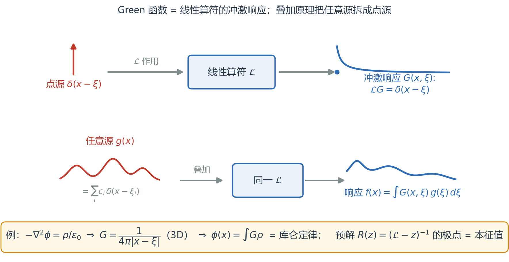
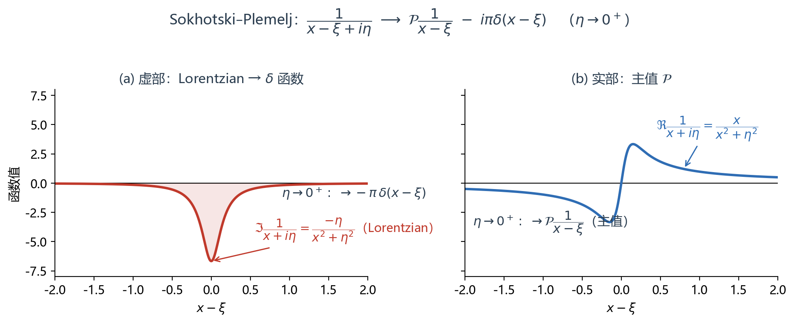
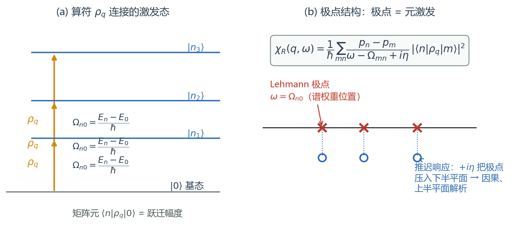
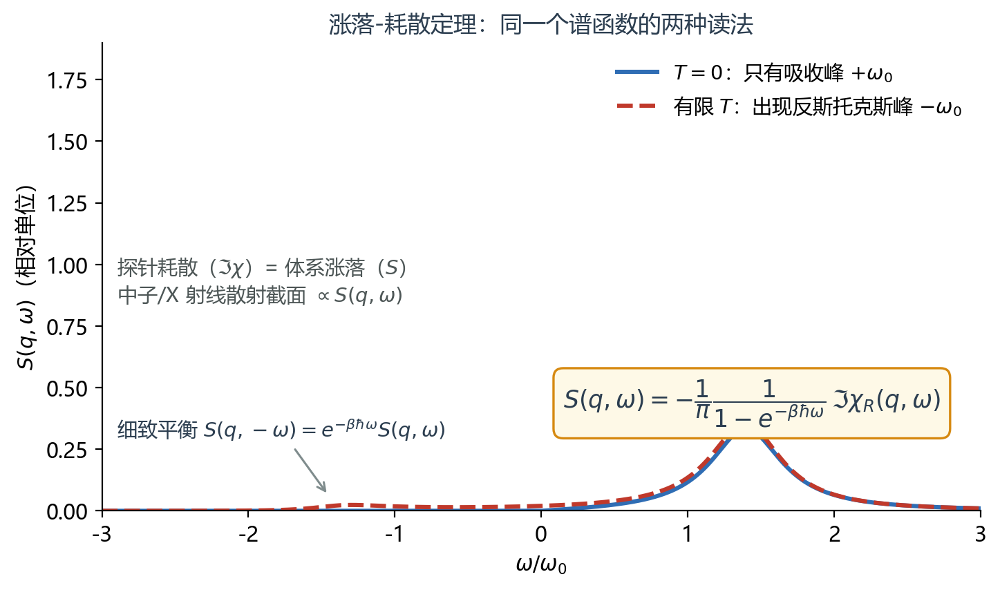
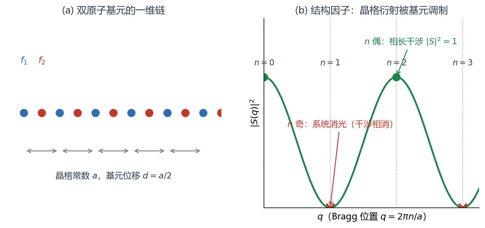
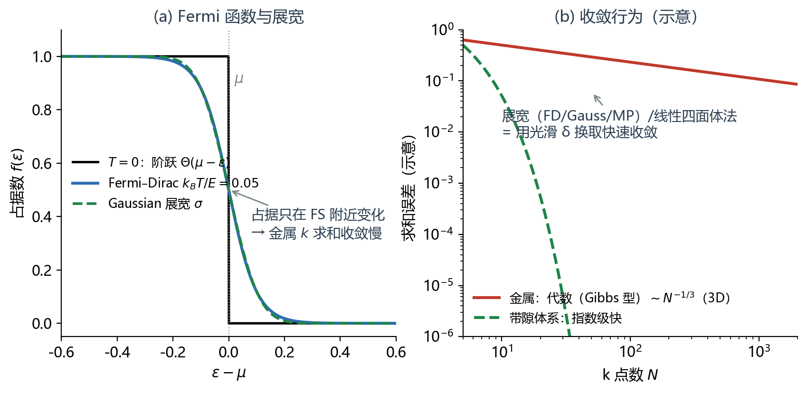
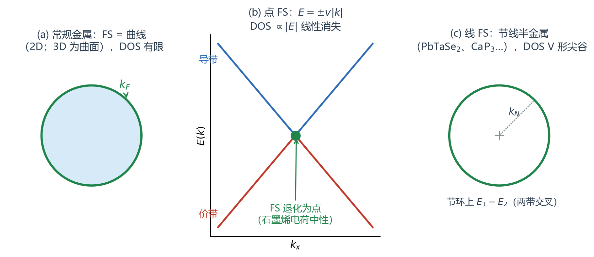

# 方程的起源（Equation Origin）

> **定位**：这是 [25-10-17-equation-origin](25-10-17-equation-origin.md) 的完整版——补齐其 "to be completed"（结构因子一节）、回答 `Program-Response-Learn` 笔记遗留的问题（"Lehmann 表示如何对应单粒子激发？"）、并展开 "Fermi surface 退化" 一句带过的伏笔。线上考据（Kubo 1957、Lehmann 1954、van Hove 1954、Sokhotski–Plemelj、Monkhorst–Pack、展宽方案）已逐条核实，引用见文末。本文是方法论母题，应用实例见 [26-11-08-plasmon-v02](26-11-08-plasmon-v02.md)。

---

## 0. 一句话与全景

**线性响应的积分公式，不过是量子运动方程的 Green 函数解；Green 函数的极点，就是体系的元激发。**（`Program-Response-Learn` 2026-07-20 的原文结论——本文把这句话展开成可查证的链条。）

三个母题贯穿全文：

1. **Green 函数**：线性算符 $\mathcal{L}$ 的冲激响应；叠加原理把任意源拆成点源（§1）；
2. **谱表示**：$\delta$ 函数的谱实现 $1/(x-\xi+i\eta)$；响应函数的极点 = 跃迁能（§2–§3）；
3. **求和**：sum over states 的两种身份（总量 vs 加权和）、周期性与结构因子、BZ 采样的数值实现（§5–§6）。

---

## 1. Response in general：$\mathcal{L}f=g$ 的普遍解

给定线性算符的场方程 $\mathcal{L}f(x)=g(x)$，叠加原理允许定义 **Green 函数**

$$\mathcal{L}G(x,\xi)=\delta(x-\xi)\quad\Longrightarrow\quad f(x)=\int G(x,\xi)\,g(\xi)\,d\xi.$$

$G$ 就是**冲激响应**（Heaviside 的电路语言）：把任意源分解为点源的叠加，每个点源的响应按幅度平移叠加回去。

**两个母例子**（原始笔记的出发点）：

| 方程 | 算符 | Green 函数 | 物理内容 |
|---|---|---|---|
| $-\nabla^2\phi=\rho/\varepsilon_0$ | $-\nabla^2$ | $G=\dfrac{1}{4\pi|x-\xi|}$（3D） | 库仑定律；2D 为 $\frac{1}{2\pi}\ln|x-\xi|$ |
| $\hat H\psi=i\partial_t\psi$ | $\hat H$（预解） | $R(z)=(\hat H-z)^{-1}$ | 谱：极点=本征值 |

- ⚠ **符号约定**：$-\nabla^2$ 的 Green 函数是 $+1/4\pi r$；若把方程写成 $\nabla^2\phi=-\rho/\varepsilon_0$（同一方程！），则 $G=-1/4\pi r$。高斯单位教材写 $\nabla^2\phi=4\pi\rho$、$G=1/r$。先声明算符符号再写 $G$。
- **预解（resolvent）观点**：$R(z)=(\mathcal{L}-z)^{-1}$ 在复平面除谱外全纯；自伴算符离散谱下 $G(x,\xi;z)=\sum_n\frac{\varphi_n(x)\varphi_n^*(\xi)}{\lambda_n-z}$ —— **极点恰好落在本征值上**（留数=谱投影）；连续谱给出割线，边值 $z=\lambda\pm i0$（Stone 公式）恢复谱测度。"极点=元激发"在数学上就是这句话。

---

## 2. 谱实现：$\delta$ 函数与 $1/(x-\xi+i\eta)$

原始笔记的"spectral realization for $\delta(x-\xi)$ is $1/(x-\xi+i\eta)$"需要收敛因子 $\eta\to0^+$ 才严格。**Sokhotski–Plemelj 定理**：

$$\lim_{\eta\to0^+}\frac{1}{x-\xi+i\eta}=\mathcal{P}\frac{1}{x-\xi}\;-\;i\pi\delta(x-\xi)$$

- 虚部是宽度 $\eta$ 的 Lorentzian，$\eta\to0$ 时 → $-\pi\delta$；实部 → 主值 $\mathcal{P}$。**这就是"谱线 = δ 函数 + 主值色散"的出生证明**：任何响应函数的 $\Im$ 部给出吸收（δ 型峰），$\Re$ 部由主值积分给出色散位移。
- ⚠ 符号陷阱：$+i\eta \Rightarrow -i\pi\delta$；$-i\eta \Rightarrow +i\pi\delta$。翻错则全部谱函数变号。
- **推迟 vs 超前**：推迟函数 $G^R\propto -i\theta(t)$ 极点在**下半平面**（$\omega\to\omega+i\eta$ 分母约定）→ 上半平面解析 → **因果**；超前 $G^A\propto +i\theta(-t)$ 在下半平面解析。时序函数 $G^T$ 三者共享同一条谱密度 $A(\omega)=-\frac{1}{\pi}\Im G^R$，只差 $i\eta$ 处方。

---

## 3. Kubo 公式与 Lehmann 表示：极点 = 元激发

外场耦合 $H'= -f_{\rm ext}(t)B$，观测量响应 $\delta\langle A(t)\rangle=\int\chi_{AB}(t-t')f_{\rm ext}(t')\,dt'$，其中 **Kubo 响应函数**（Kubo, JPSJ 12, 570 (1957)）：

$$\chi_{AB}(t)=-\frac{i}{\hbar}\theta(t)\,\langle[A(t),B(0)]\rangle_0$$

插入完备基 $\sum_n|n\rangle\langle n|=1$（**Lehmann / 谱表示**，Lehmann, Nuovo Cimento 11, 342 (1954)；Källén 1952）：

$$\boxed{\ \chi_R(q,\omega)=\frac{1}{\hbar}\sum_{mn}\frac{p_n-p_m}{\omega-\Omega_{mn}+i\eta}\,\big|\langle n|\rho_q|m\rangle\big|^2\ },\qquad \Omega_{mn}=\frac{E_m-E_n}{\hbar}$$

**回答 Program-Response-Learn 的遗留问题——Lehmann 表示如何对应单粒子激发？**

- $\rho_q=\sum_k c^\dagger_{k+q}c_k$ 是**单粒子算符**：在 Slater 行列式基下，$\langle n|\rho_q|m\rangle$ 只连接**相差一个粒子-空穴对**（$k$ 占据 → $k+q$ 空着）的态。$T=0$ 时 Lehmann 求和坍缩成

$$\Pi^0(q,\omega)=2\sum_{\mathbf k}\frac{f(\varepsilon_{\mathbf k})-f(\varepsilon_{\mathbf k+\mathbf q})}{\hbar\omega+\varepsilon_{\mathbf k}-\varepsilon_{\mathbf k+\mathbf q}+i0^+}\quad\text{——即 Lindhard / 极化函数}$$

- 所以**独立粒子近似下，"单粒子激发"就是全部**；相互作用体系还允许矩阵元连到双粒子-空穴、集体模等**多体激发**（矩阵元不再坍缩），RPA 正是把 p-h 部分自洽化（$\epsilon=1-V\Pi^0$，见等离激元笔记 §2）。
- 极点在跃迁能 $\Omega_{mn}$ 处：**谱权重的位置 = 元激发能量**；$p_n-p_m$（占据差）给出吸收方向性；$\Im\chi\le0$（$\omega>0$）保证耗散为正。

**光学实例（Kubo–Greenwood）**：$\sigma_1(\omega)=\dfrac{2\pi e^2}{3m^2\omega\,\Omega}\sum_{i,f}(f_i-f_f)\,|\langle f|\mathbf v|i\rangle|^2\,\delta(E_f-E_i-\hbar\omega)$ —— "吸收 = 占据差加权的跃迁谱"（Greenwood, Proc. Phys. Soc. 71, 585 (1958)）。

---

## 4. 涨落-耗散与 Kramers-Kronig：同一谱函数的两种读法

**动力学结构因子**（van Hove 关联函数的时空 Fourier，van Hove, Physica 21, 517 (1954)）：

$$S(q,\omega)=\sum_{mn}p_n\,|\langle n|\rho_q|m\rangle|^2\,\delta(\omega-\Omega_{mn})=\frac{1}{2\pi N}\int dt\,e^{-i\omega t}\langle\rho_q(t)\rho_{-q}(0)\rangle$$

**涨落-耗散定理（FDT）**（Callen & Welton, PR 83, 34 (1951)）把"探针看到的耗散"与"体系自发的涨落"焊死：

$$S(q,\omega)=-\frac{1}{\pi}\,\frac{1}{1-e^{-\beta\hbar\omega}}\,\Im\chi_R(q,\omega)$$

- $T=0$：只有 $\omega>0$ 的吸收峰；有限 $T$ 出现反斯托克斯峰，**细致平衡** $S(q,-\omega)=e^{-\beta\hbar\omega}S(q,\omega)$；
- 散射实验直接测它：中子 $d^2\sigma/d\Omega d\omega=(k_f/k_i)|b|^2 S(q,\omega)$；EELS 测 $-\Im\epsilon^{-1}$（Coulomb 探针版的同一逻辑，见等离激元笔记 §1）；
- ⚠ FDT 的负号依赖 $\Im\chi_R<0$（$\omega>0$）约定；Bose 因子位置各教材不同，引用时先对约定。

**Kramers-Kronig**：因果性（$\chi(t<0)=0$）⇒ $\chi(\omega)$ 在上半平面解析 ⇒ 实部/虚部互为 Hilbert 变换：

$$\Re\chi(\omega)=\frac{1}{\pi}\mathcal{P}\!\int\frac{\Im\chi(\omega')}{\omega'-\omega}d\omega',\qquad \Im\chi(\omega)=-\frac{1}{\pi}\mathcal{P}\!\int\frac{\Re\chi(\omega')}{\omega'-\omega}d\omega'$$

（Kramers 1927 光学色散；Kronig 1926 X 射线吸收。⚠ 积分核是 $\omega'-\omega$。）应用：等离激元阻尼边界的长波 RPA+KK 分析、由反射率反推 $\epsilon(\omega)$。

---

## 5. 周期性：$ab=I$ 与结构因子（补全 "to be completed"）

原始笔记："Given a set of lattice vectors … periodicity allows me to define $ab=I$ … structure factor." 展开：

**两种约定，先选边**：
- 物理约定（Kittel / Ashcroft–Mermin）：$\mathbf a_i\cdot\mathbf b_j=2\pi\delta_{ij}$，$e^{i\mathbf G\cdot\mathbf R}=1$ 免去系数；
- 晶体学约定（International Tables；**$ab=I$ 属于这里**）：$\mathbf a_i\cdot\mathbf b_j=\delta_{ij}$，$|\mathbf b|$ 直接读作 $1/d$。两者差一个 $2\pi$，**下游所有公式跟着变**（$\mathbf G=h\mathbf b_1+\cdots$ vs $2\pi(h\mathbf b_1+\cdots)$）。

**结构因子**（晶胞的散射幅度）：$S_{\mathbf G}=\sum_j f_j\,e^{i\mathbf G\cdot\mathbf r_j}$，强度 $|S|^2$ 与符号约定无关。经典系统消光（可以当成"周期性 × 基元干涉"的练习）：
- **bcc**（基元 $0,\frac12\frac12\frac12$）：$S=f\big(1+e^{i\pi(h+k+l)}\big)$ → $h+k+l$ 奇时消光；
- **fcc**（面心四点基元）：$h,k,l$ 全偶或全奇才有峰，混杂奇偶消光；
- **diamond**（fcc + $\frac14\frac14\frac14$）：再叠加 $1+e^{i\pi(h+k+l)/2}$ → 200、222 也消失。

**动态版**：把 $S_{\mathbf G}$ 推广为 $S(q,\omega)$（§4），静态 Bragg 峰（弹性，$\omega=0$）与动态散射谱（非弹性）是同一家族的两个极限——晶格给出动量量子 $G$，基元与动力学给出形状与谱。

**与等离激元的接口**：局域极限忽略 $q\to q+G$ 的变化（no LFE）；莫尔体系 $G_M$ 恰好够小、$\lambda_p$ 与 $L_M$ 同量级 → LFE 不可忽略 → $\epsilon_{GG'}$ 矩阵、等离激元微带（等离激元笔记 §8）。**响应函数永远是"晶格动量分瓣"的**——这就是结构因子进入响应理论的入口。

---

## 6. 响应数值实现的 add-ons

原始笔记的 "Add-ons in response realization" 三件套 + sum over states：

### 6.1 Brillouin zone sampling（效率）

- **Monkhorst–Pack 网格**（PRB 13, 5188 (1976)）：$u_r=\frac{2r-q-1}{2q}$，$\mathbf k_{prs}=u_p\mathbf b_1+u_r\mathbf b_2+u_s\mathbf b_3$——均匀等差特殊点（正是 `IBZ积分与对称性` 笔记的公式）；fcc/六方需 $\Gamma$-居中网格保对称性；非立方体心按正格矢倒数比细分。
- **对称性再省一半以上**：只在不可约 BZ（IBZ）求和，权重按点群复制回去。
- ⚠ **line mode（高对称路径）只用于画能带**，不能用来积总能量/DOS——没有均匀覆盖。

### 6.2 Fermi function（热涨落与数值 δ）

$f(\varepsilon)=\frac{1}{e^{(\varepsilon-\mu)/k_BT}+1}\xrightarrow{T\to0}\Theta(\mu-\varepsilon)$。金属中占据在 FS 上**不连续**，k 求和出现 Gibbs 型振荡，误差只代数收敛（3D 常引 $\sim N^{-1/3}$）；能隙体系指数收敛。**展宽 = 用光滑的 δ 代替尖锐占据**换取快速收敛：

| 方案 | 引用 | 特点 |
|---|---|---|
| Fermi–Dirac | 教科书 | 物理温度，慢 |
| Gaussian | — | 单调占据 |
| Methfessel–Paxton | PRB 40, 3616 (1989) | Hermite 展开 δ，快；**占据可为负**（力易出错） |
| Marzari–Vanderbilt "cold" | PRL 82, 3296 (1999)（Al(110) 表面文中提出） | 正占据、能量-力折中 |
| 线性四面体法 | Blöchl–Jepsen–Andersen, PRB 49, 16223 (1994) | 无展宽参数，DOS/总能皆准（VASP ISMEAR=-5） |

### 6.3 Fermi Surface（"convention breaks once the surface degenerates"）

金属的 FS 是 $(d-1)$ 维流形（2D 曲线 / 3D 曲面）；**退化情形打破常规**：

- **点 FS**：石墨烯电荷中性（Dirac 锥相接），DOS $\propto|E|$ **线性消失** → 常规金属的"态密度常数"推导全部失效（屏蔽弱化：石墨烯节点内 Friedel $\propto1/r^2$，见等离激元笔记 §4）；HgTe 量子阱临界厚度 $d_c\approx6.3$ nm 同类。
- **线 FS**（节线半金属）：PbTaSe₂（ARPES 首证）、CaP₃、graphdiyne——两带沿闭合环交叉，DOS 呈 **V 形线性尖谷**；自旋轨道耦合可以打开小能隙（PbTaSe₂ 即因此可测）。
- 结果：**FS 的维度决定响应函数的奇异性**——这正是一切"非常规屏蔽/非常规等离激元色散"的几何根源。

### 6.4 sum over states：总量的两种身份

- **加权求和（期望值）**：$\langle O\rangle=\sum_n p_n O_n$；**总量（广延量）**：$E=\sum_{n\mathbf k}f_{n\mathbf k}\varepsilon_{n\mathbf k}$ —— 同一个"权重 × 观测量"模式；
- 谱函数 $A(\omega)=\sum_n|\langle n|\psi\rangle|^2\delta(\omega-E_n)$ 把单位权重分给各激发——期望值变成能量加权积分；
- **求和规则就是加权恒等式**：TRK/f-sum $\sum_n(E_n-E_0)|\langle n|\hat x|0\rangle|^2=\hbar^2/2m$（每电子）⇒ $\int_0^\infty\omega\,S(q,\omega)\,d\omega$ 固定 ⇒ 等离激元笔记 §2.5 的 $\int\Re\sigma\,d\omega=\omega_p^2/8$ 与 $\int d\omega\,\omega\,\Im\Pi=\frac{nq^2}{2m}$（EWSR）。对角化 vs 混合表象的两种求和口径，必须给出相同谱权——数值一致性核验的理论依据。

---

## 7. 术语速查表（中英对照）

| English | 中文 | 一句话 |
|---|---|---|
| Green's function | 格林函数 | 线性算符的冲激响应，$\mathcal{L}G=\delta$ |
| impulse response | 冲激响应 | 点源输入的系统输出（Heaviside） |
| resolvent | 预解算符 | $(\mathcal{L}-z)^{-1}$，极点=谱 |
| retarded / advanced | 推迟 / 超前 | 因果 / 反因果的 $i\eta$ 处方 |
| spectral (Lehmann) representation | 谱（Lehmann）表示 | 响应函数按跃迁矩阵元求和 |
| spectral weight | 谱权重 | 可激发强度，守恒可转移 |
| Sokhotski–Plemelj theorem | 索霍茨基–普勒梅利定理 | $1/(x+i\eta)\to\mathcal{P}\frac1x-i\pi\delta$ |
| Kubo formula | 久保公式 | $\chi=-\frac{i}{\hbar}\theta(t)\langle[A,B]\rangle$ |
| Kubo–Greenwood | 久保–格林伍德公式 | 光学电导的跃迁求和 |
| dynamical structure factor | 动力学结构因子 | $S(q,\omega)$，van Hove 关联的谱 |
| fluctuation–dissipation theorem | 涨落-耗散定理 | $S$ 与 $\Im\chi$ 的 Bose 因子桥 |
| detailed balance | 细致平衡 | $S(-\omega)=e^{-\beta\hbar\omega}S(\omega)$ |
| Kramers–Kronig relations | 克拉默斯-克勒尼希关系 | 因果 ⇒ 实虚部互为 Hilbert 变换 |
| reciprocal lattice | 倒易点阵 | $ab=I$（晶体学）或 $2\pi\delta$（物理） |
| structure factor | 结构因子 | 晶胞散射幅度 $S_G=\sum_j f_j e^{iG\cdot r_j}$ |
| systematic absences | 系统消光 | 基元干涉相消的衍射禁戒 |
| Brillouin zone sampling | 布里渊区采样 | MP 网格 / IBZ / 高对称路径 |
| smearing | 展宽（抹平） | 光滑 δ 换取 k 求和快速收敛 |
| tetrahedron method | 四面体方法 | 无展宽参数的 BZ 积分 |
| Fermi surface degeneracy | 费米面退化 | FS 降维为点/线，DOS 反常 |
| Dirac point / nodal line | 狄拉克点 / 节线 | 点 FS / 线 FS 的载体 |
| sum over states | 态求和 | 总量与加权期望的两种身份 |
| TRK / f-sum rule | TRK / f 求和规则 | 能量加权恒等式（谱权守恒） |

**历史一分钟**：Green 1828（自费出版的小册子，势理论；Kelvin 1845 挖掘推广）→ Heaviside 1880s（算子微积分/冲激响应）→ Kirchhoff 1882（波动积分定理）→ Kramers 1927 / Kronig 1926（色散关系）→ Källén 1952 / Lehmann 1954（传播子谱表示）→ van Hove 1954（时空关联）→ Callen–Welton 1951（FDT）→ Kubo 1957（线性响应一般理论）→ Monkhorst–Pack 1976（BZ 特殊点）。

---

## 8. 参考资料（已核实）

- G. Green, *An Essay on the Application of Mathematical Analysis to the Theories of Electricity and Magnetism* (Nottingham, 1828)；arXiv:0807.0088 有转录
- R. Kubo, *J. Phys. Soc. Jpn.* **12**, 570–586 (1957)；D. A. Greenwood, *Proc. Phys. Soc.* **71**, 585 (1958)
- H. Lehmann, *Nuovo Cimento* **11**, 342 (1954)；G. Källén, *Helv. Phys. Acta* **25**, 417 (1952)
- L. van Hove, *Physica* **21**, 517 (1954)；*Phys. Rev.* **95**, 249 (1954)
- H. B. Callen & T. A. Welton, *Phys. Rev.* **83**, 34 (1951)
- H. J. Monkhorst & J. D. Pack, *Phys. Rev. B* **13**, 5188 (1976)
- M. Methfessel & A. T. Paxton, *Phys. Rev. B* **40**, 3616 (1989)；N. Marzari et al., *Phys. Rev. Lett.* **82**, 3296 (1999)；P. E. Blöchl et al., *Phys. Rev. B* **49**, 16223 (1994)
- R. M. Martin, *Electronic Structure: Basic Theory and Practical Methods*, **2nd ed., Cambridge University Press, 2020**（原始笔记 "Martin (2020)" 即此书；姊妹篇 Martin–Reining–Ceperley, *Interacting Electrons*, CUP 2016）
- G. D. Mahan, *Many-Particle Physics*；A. L. Fetter & J. D. Walecka, *Quantum Theory of Many-Particle Systems*；H. Bruus & K. Flensberg, *Many-Body Quantum Theory in Condensed Matter Physics*
- I. Errea (CFM/Master lecture 3), *Response Properties of the Electronic System in Low Dimensions*：`https://cfm.ehu.es/errealab/wp-content/uploads/2021/12/3_Response_Properties_of_the_Electronic_System_in_Low_Dimensions.pdf`（原知识库引用的网络讲义，作者已核实）
- L. Cavicchi & M. Polini, *ACS Photonics* **12**, 3961 (2025)（`IBZ积分与对称性` 笔记所引综述）

**自己笔记的脉络**：[25-10-17-equation-origin](25-10-17-equation-origin.md)（原始速记，本文补全）→ `Notes\QuMaMathPhys_md\eqn\nonhomo.md`（Green 函数 PDE 起点）→ `Notes\学习与基础参考\记录与归档\20260720-Program-Response-Learn【响应理论】.md`（遗留问题，本文 §3 回答）→ [26-11-08-plasmon-v02](26-11-08-plasmon-v02.md)（应用：Π⁰、ε、阻尼、谱权）。

---

## 9. 本地资源导航（D:\1-进行中）

| 资源 | 路径 |
|---|---|
| 原始笔记 | `D:\1-进行中\my-notes\25-10-17-equation-origin.md` |
| Green 函数 PDE 笔记 | `D:\1-进行中\Notes\QuMaMathPhys_md\eqn\nonhomo.md`、`eqn\Neu.md` |
| IBZ 积分与对称性（MP 网格细则） | `D:\1-进行中\Notes\学习与基础参考\模型与计算\IBZ积分与对称性【数值方法】.md` |
| 响应理论学习日志（本文回答其问题） | `D:\1-进行中\Notes\学习与基础参考\记录与归档\20260720-Program-Response-Learn【响应理论】.md` |
| 对称性 → 响应链路（群论约束/介电张量） | `D:\1-进行中\Notes\学习与基础参考\综合资料\20260910-对称性到响应链路-群论约束选择定则与介电张量【通用学习】-v1.md` |
| Martin《Electronic Structure》2nd ed. (2020) 等教材 | `D:\1-进行中\Literature\`（按主题检索） |
| 本文插图 | `D:\1-进行中\my-notes\plot\equation-origin\` |

<!-- 可选：告诉 MathJax 我们要用 $...$ 做行内定界符 -->

<!-- 真正加载 MathJax v3（官方 CDN） -->

