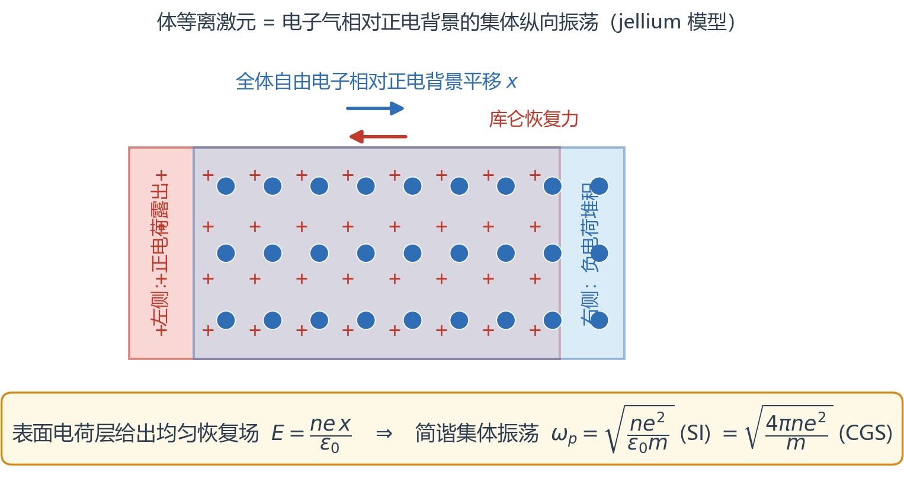
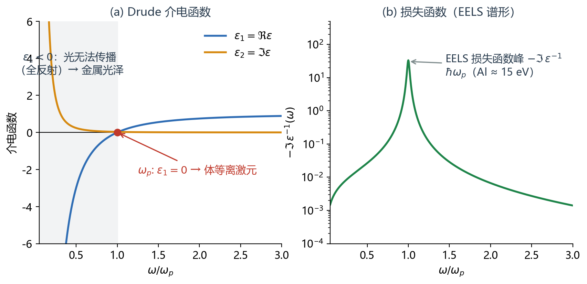
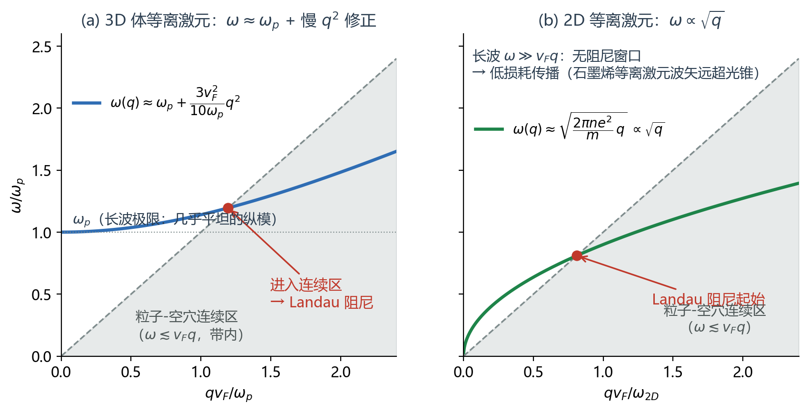
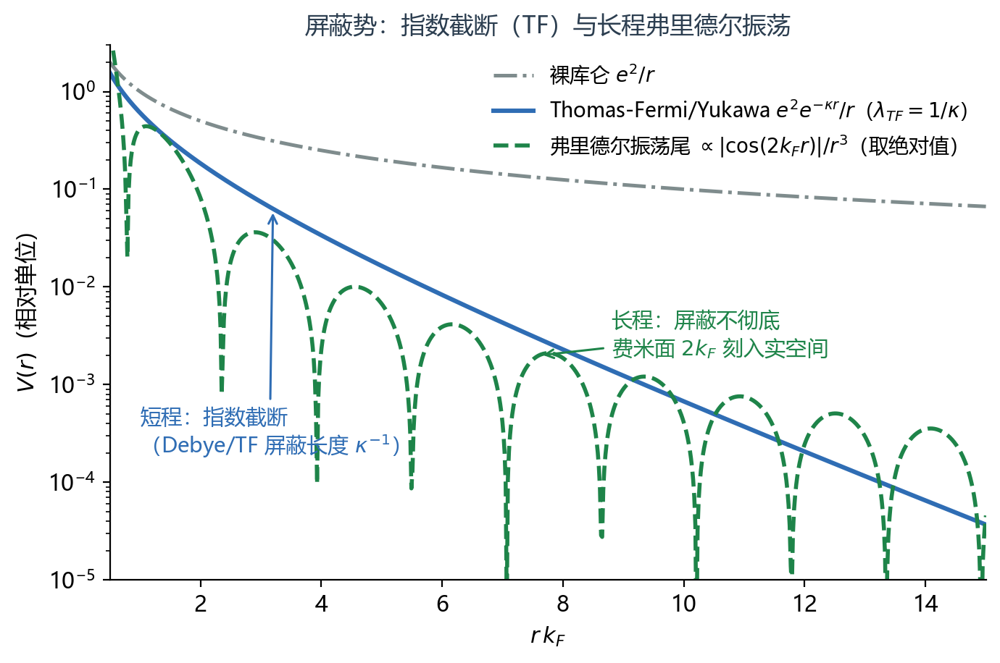
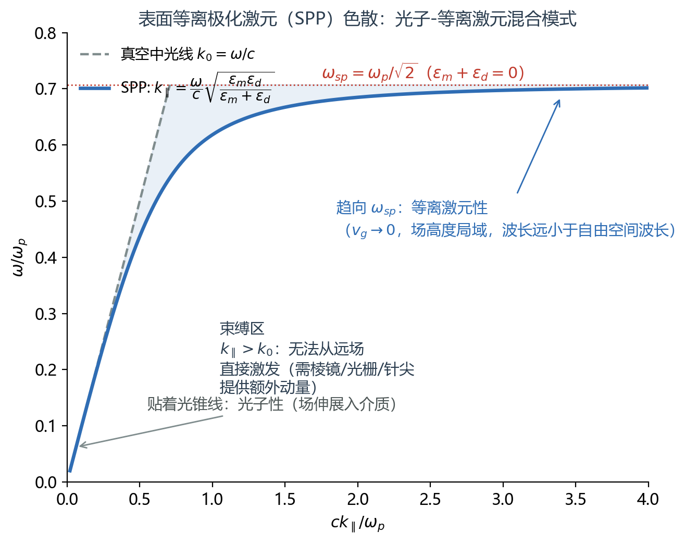
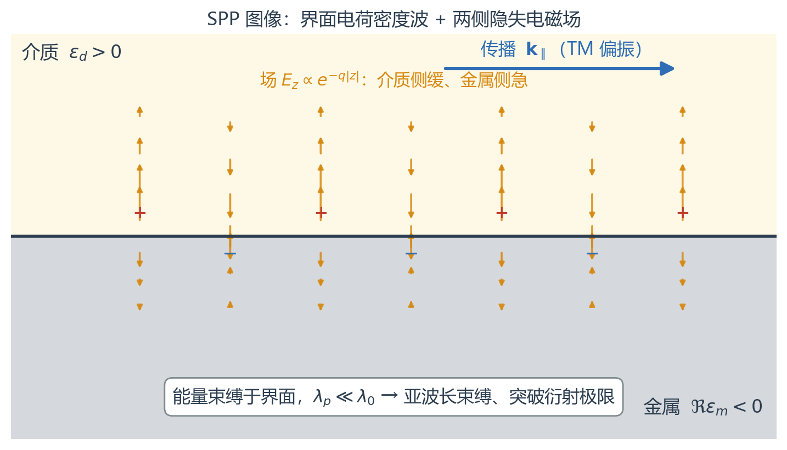
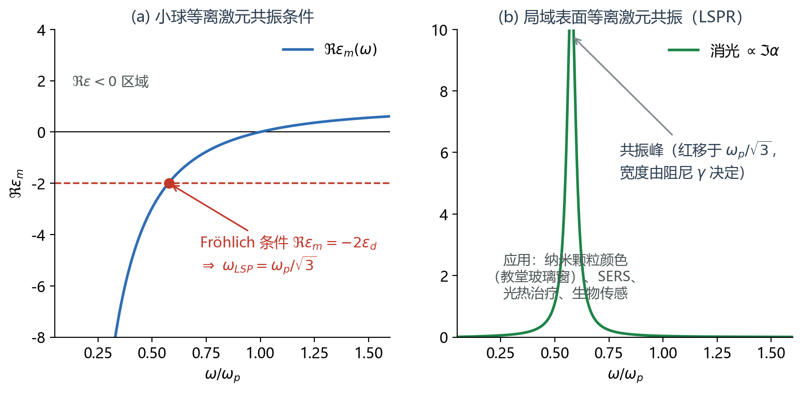
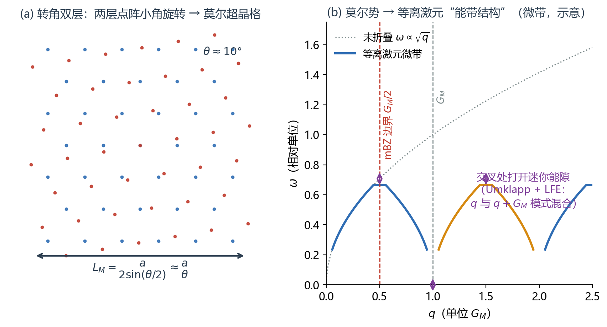

# 等离激元（Plasmon）完整描述

> **定位**：这是 [25-07-04-plasmons](25-07-04-plasmons.md)（教材 § 4.1.3(5) & § 4.3.5 笔记）与 [25-10-26-plasmon-v01](25-10-26-plasmon-v01.md) 的完整版：补齐 v01 中全部 TBD，并把 `Notes\等离激元\` 知识库（主控台、色散计算工作流、概念框架-D 等）的核心内容整合为一份自带插图的自洽讲义。单位约定：**主体 CGS（含 4π），关键处给 SI 对照**，沿用知识库口径。

---

## 0. 一句话与全景

**plasma（等离子体）** 是含至少一种可动电荷的介质；其**纵向集体振荡**（plasma oscillation）量子化后即为 **plasmon（等离激元）**。它与声子、光子同类：一个有明确能量–动量关系的元激发（elementary excitation / quasiparticle）。

| 家族成员 | 发生在哪里 | 谁来激发 | 标志 |
|---|---|---|---|
| 体等离激元 bulk plasmon | 均匀金属内部（纵模） | 高能电子束（EELS），反射谱**不**激发 | $\hbar\omega_p$，Al ≈ 15 eV |
| 表面等离极化激元 SPP | 金属–介质界面（TM 混合模） | 棱镜/光栅/针尖耦合 | $k_\parallel>k_0$，亚波长束缚 |
| 局域等离激元 LSPR | 纳米颗粒（准静态） | 远场光即可 | $\Re\varepsilon_m=-2\varepsilon_d$ 共振 |
| 2D 等离激元 | 2DEG / 石墨烯 | 光栅、针尖（s-SNOM）、EELS | $\omega\propto\sqrt q$，波长远短于光波长 |
| 莫尔等离激元 | TBG / 莫尔超晶格 | 同上 + 莫尔倒格矢供动量 | 等离激元微带、关联态指纹 |

能量–波长对应关系见本站交互图 [plot/index.html](plot/index.html)（频率 vs 波数，等离子体频率 = 可穿透金属的频率底线）。

---

## 1. 体等离激元：从 jellium 到 $\omega_p$

**模型**（jellium / 凝胶模型）：均匀正电背景 + 自由电子气。让全体电子相对正电背景平移 $x$：两侧表面出现厚度 $x$ 的电荷层，内部产生均匀恢复场 $E=ne\,x/\varepsilon_0$（SI），单个电子受 $m\ddot x=-eE$ —— 简谐振动：

$$\boxed{\ \omega_p=\sqrt{\frac{ne^2}{\varepsilon_0 m}}\ \text{(SI)}\ =\sqrt{\frac{4\pi ne^2}{m}}\ \text{(CGS)}\ }$$

**光学后果**：无阻尼 Drude 介电函数

$$\varepsilon(\omega)=1-\frac{\omega_p^2}{\omega(\omega+i/\tau)},\qquad \varepsilon_1(\omega)=1-\frac{\omega_p^2}{\omega^2}.$$

- $\omega<\omega_p$：$\Re\varepsilon<0$，体内无传播解 → 光全反射 → **金属光泽**；
- $\omega>\omega_p$：$\Re\varepsilon>0$，光可透过（紫外透明）；
- $\varepsilon_1=0$：纵振荡可以自持（无外场也成立）→ **体等离激元**，能量 $\hbar\omega_p$。它是**纵模**，所以常规反射谱激发不了，要用 EELS（电子能量损失谱）：损失函数

$$L(\omega)=-\Im\,\varepsilon^{-1}(\omega)$$

的峰位即 $\omega_p$（Al ≈ 15 eV；灰色锡 1972 年测量见 [25-07-04-plasmons](25-07-04-plasmons.md)）。

---

## 2. 响应函数框架（Formulation）

### 2.1 一般观点：集体激发 = 响应函数的极点

任何线性响应都长一个样（见 [25-10-17-equation-origin](25-10-17-equation-origin.md)）：给定场方程 $Lf=g$，定义 Green 函数 $LG(x,\xi)=\delta(x-\xi)$，则 $f=G\ast g$；谱实现即 $1/(x-\xi+i\eta)$。密度响应同理：

$$\chi(q,\omega)\ \sim\ \sum_n\frac{|\langle 0|\hat\rho_q|n\rangle|^2}{\hbar\omega-(E_n-E_0)+i0^+}$$

**等离激元 = 自洽响应的发散点/介电函数的零点**。这正是"response kernel 是连结 dispersion 的桥梁"的含义。

### 2.2 RPA：$\epsilon=1-V(q)\Pi(q,\omega)$

无互作用密度-密度响应（Lindhard / 极化函数）：

$$\Pi^0(\mathbf q,\omega)=2\sum_{\mathbf k}\frac{f(\varepsilon_{\mathbf k})-f(\varepsilon_{\mathbf k+\mathbf q})}{\hbar\omega+\varepsilon_{\mathbf k}-\varepsilon_{\mathbf k+\mathbf q}+i0^+}$$

RPA 介电函数 $\epsilon=1-V(q)\Pi^0$。教材里的完整矩阵元版本（SI、含弛豫 $\tau_{n,n'}$）：

$$\epsilon(\omega,q) = 1 - \frac{e^2}{2\epsilon_0 q}\sum_{n,n',\vec{k}}\frac{\left\vert\langle\vec{k},n\vert e^{-i\vec{q}\cdot\vec{r}}\vert\vec{k}+\vec{q},n'\rangle\right\vert^2}{E_{\vec{k}+\vec{q},n'}-E_{\vec{k},n}-\hbar\omega-i\hbar/\tau_{n,n'}}\times\left[f\left(E_{\vec{k}+\vec{q},n'}\right)-f\left(E_{\vec{k},n}\right)\right]$$

**等离激元条件**（实际判据）：

$$\epsilon(q,\omega)=0\quad\Leftrightarrow\quad \Re\epsilon=0\ \text{且}\ \Im\epsilon\ \text{尽量小}.$$

### 2.3 库仑核按维度

| 维度 | $V(q)$（CGS） | $V(q)$（SI） |
|---|---|---|
| 3D | $\dfrac{4\pi e^2}{q^2}$ | $\dfrac{e^2}{\varepsilon_0 q^2}$ |
| 2D | $\dfrac{2\pi e^2}{q}$ | $\dfrac{e^2}{2\varepsilon_0 q}$ |
| slab（混合表象） | $\dfrac{2\pi e^2}{q}\,e^{-q|z-z'|}$ | — |

（2D/3D 可由 Yukawa 势 $v(r,\kappa)=e^2e^{-\kappa r}/r$ 的 Fourier 变换 $v_q(\kappa)$ 取 $\kappa\to0$ 得到——25-07-04 笔记的 easy exercise。）

### 2.4 ⚠ 极限顺序不可交换

- **先 $\omega\to0$**（$q$ 有限）：静态屏蔽 → Thomas-Fermi / Stern（§4）；
- **先 $q\to0$**（$\omega$ 有限）：光学极限 → Drude 电导与等离激元。严格 $q=0,\ \omega\neq0$ 时 $\Pi=0$（电荷守恒/规范不变）；光学响应必须"保留 $q$ 依赖 + 连续性方程 $\sigma_L=\frac{ie^2\omega}{q^2}\Pi$" 再取极限，得 $\sigma(\omega)=\dfrac{ne^2/m}{1/\tau-i\omega}$、$\varepsilon(\omega)=1-\dfrac{\omega_p^2}{\omega(\omega+i/\tau)}$。

### 2.5 谱权重、Drude weight 与 f-sum rule

- **谱权重 spectral weight**：可激发强度，其转移 = 跃迁概率在不同频率区间的重新分布。
- **Drude weight（德鲁德权重 / charge stiffness）**：$\Re\sigma(\omega)=2\pi D\,\delta(\omega)+\sigma_{\rm reg}$ 中的 $D$——**长波极限电导谱权的集体模强度，明确 ≠ DC 电导率**（$\sigma_{DC}=D\cdot\tau$，$D$ 本身不含散射）。Galilean 不变体系 $D=ne^2/2m=\omega_p^2/8\pi$（CGS），用**裸质量**、不受 e-e 相互作用重整化；$D>0$ 金属、$D=0$ 绝缘体（Mott 转变序参量；Anderson 局域化时 $D=0$）。晶格体系 $D=\frac{e^2a^2}{2\hbar^2V}\langle-\hat T_x\rangle$；Kohn 方法用扭转边界条件 $D=\frac{L}{2}\partial^2_\phi e_0(\phi)|_{\phi=0}$。
- **f-sum rule（EWSR 能量加权求和规则）**：$\displaystyle\int_0^\infty\Re\sigma\,d\omega=\frac{\pi ne^2}{2m}=\frac{\omega_p^2}{8}$；等价 $\displaystyle\int_0^\infty\omega\,\Im\epsilon\,d\omega=\frac{\pi}{2}\omega_p^2$；有限 $q$：$\displaystyle\int_0^\infty d\omega\,\omega\,\Im\Pi(q,\omega)=\frac{nq^2}{2m}$（与相互作用无关）。**等离激元把连续谱权重集中到峰位，但总量守恒——这就是"谱权重转移"**，也是数值一致性的核验口径。
- 顺磁项（真实跃迁，频率依赖）+ 抗磁项（$A^2$ 直接反作用，常数背景）**之和**才保证规范不变性，单独看任何一项都会错。

---

## 3. 色散与朗道阻尼

RPA 零点给出色散 $\omega(q)$：

- **3D**：$\ \omega(q)\approx\omega_p+\dfrac{3v_F^2}{10\omega_p}q^2$ —— 长波几乎平坦的纵模，$q^2$ 缓慢上翘；
- **2D**（2DEG，Stern 1967）：$\ \omega^2(q)=\dfrac{2\pi ne^2}{m}q+\dfrac34 v_F^2q^2+\cdots$ —— **$\omega\propto\sqrt q$**，无能隙色散；
- **表面**（金属–真空）：$\epsilon(\omega)+1=0\Rightarrow\omega_s=\omega_p/\sqrt2$。

**Landau 阻尼的物理图像**：$\Im\Pi\neq0$ 的区域是**粒子-空穴连续区**（带内边界 $\omega\lesssim v_Fq$；带间边界 $\omega\gtrsim$ 带间阈值）。等离激元色散曲线一旦进入连续区，就与单粒子激发共振、衰减为粒子-空穴对——模式"消失"（宽化、猝灭）。因此寻找等离激元 = 找 $\Re\epsilon=0$ **且** $\Im\epsilon$ 小的窗口：

- 3D：长波 $\omega_p\gg v_Fq$，等离激元在连续区之上，阻尼小；大 $q$ 进入连续区被吸收。
- 2D：长波 $\omega\propto\sqrt q\gg v_Fq$ 存在**无阻尼窗口**——这正是石墨烯等离激元能低损传播、波矢远超光锥的原因；石墨烯带间区（$\omega>2E_F$）色散反向硬化（Lewandowski–Levitov 的适定性分析）。

阻尼边界的定量分析工具：长波 RPA + Kramers-Kronig（见知识库 `Stauber-Fig4-朗道阻尼边界分析`）。

---

## 4. 屏蔽：同一响应函数的静态极限

屏蔽与等离激元是**同一个 $\epsilon(q,\omega)$ 的两个极限**：$\omega\to0$ 得静态屏蔽，$\omega$ 有限得集体振荡。

- **Thomas-Fermi / Debye**：$\epsilon(q,0)=1+\kappa^2/q^2$（3D），$\kappa^2=4\pi e^2D(E_F)$（CGS，$D$ = 态密度；经典等离子体 $\kappa_D=\sqrt{4\pi ne^2/k_BT}$，屏蔽长度即**德拜长度**）。实空间：Yukawa 势 $v(r)=e^2e^{-\kappa r}/r$——短程截断。
- **2D 精确静态**（Stern 1967）：$-\chi_0(q,0)/N(0)=1$（$q\le2k_F$，2D 态密度恒定的特有结果），$q>2k_F$ 出现 $1-\sqrt{1-(2k_F/q)^2}$；$2k_F$ 处的尖点即 **Kohn 反常**。RPA $\chi_{RPA}=\chi_0/(1-v(q)\chi_0)$ 把长波密度响应"刚性化"（压缩率被长程库仑压低）；局域场修正 $\chi=\chi_0/[1-v(1-G)\chi_0]$（Hubbard/STLS/QMC）。
- **Friedel 振荡**：屏蔽并不彻底——金属中精确长程尾 $\propto\cos(2k_Fr+\phi)/r^3$：费米面（$2k_F$）被"刻入"实空间。石墨烯：节点内 $1/r^2$、节点间 $1/r$；双层均 $1/r$。

---

## 5. 表面等离极化激元（SPP）

**条件**：界面两侧介电函数满足 $\epsilon_m(\omega)+\epsilon_d(\omega)=0$（金属–真空 → $\omega_{sp}=\omega_p/\sqrt2$；一般 Drude 金属+介质 $\omega_{sp}=\omega_p/\sqrt{1+\epsilon_d}$）。这就是把体等离激元"劈"出一支界面模的来源。

**SPP 色散**（TM 模，电场纵+横兼有）：

$$k_\parallel(\omega)=\frac{\omega}{c}\sqrt{\frac{\epsilon_m\epsilon_d}{\epsilon_m+\epsilon_d}}$$

- 低频端贴着光线（光子性）；趋向 $\omega_{sp}$ 时 $k_\parallel\to\infty$、群速度 $\to0$（等离激元性）；
- 全程 $k_\parallel>k_0$：**束缚模式**，相速度 $<c$，场沿 $\pm z$ 指数衰减（隐失场），能量束缚于界面附近，波长 $\lambda_p\ll\lambda_0$——**突破衍射极限的纳米光场**；
- 动量失配 $k_\parallel-k_0$ 意味着**平版金属表面上的 SPP 无法用垂直入射光激发**：需要棱镜耦合（Kretschmann/Otto，1968）、光栅、或针尖（s-SNOM）提供额外动量。$q_{\rm plasmon}=q_{\rm photon,\parallel}+G_{\rm structure}$。

**与声子极化激元的类比**（v01 笔记的 hybrid light-matter quasiparticles）：极性介质（SiC、GaAs、hBN）中横向光学声子（TO phonon）同样使 $\Re\epsilon(\omega)<0$ 出现在 Reststrahlen 带 → 界面束缚的**声子极化激元**（Surface Phonon Polariton）；hBN 是天然红外超透镜材料。同一套介电函数语言统一光子/声子/等离激元三类极化激元（Basov 2016 综述）。

---

## 6. 局域表面等离激元共振（LSPR）

当颗粒尺寸 $a\ll\lambda_0$， retardation 可忽略（准静态）：问题化为小球在均匀外场中的极化，

$$\alpha=4\pi a^3\frac{\epsilon_m-\epsilon_d}{\epsilon_m+2\epsilon_d}\ \text{(CGS)}\qquad\Rightarrow\qquad \text{共振条件 } \Re\epsilon_m=-2\epsilon_d\ \text{（Fröhlich 条件）}$$

Drude 金属+真空 → $\omega_{LSP}=\omega_p/\sqrt3$：**低于** $\omega_p$、也低于 $\omega_{sp}$。共振峰位随颗粒尺寸/形状/介质环境移动（纳米颗粒颜色、教堂玻璃窗的原理），近场增强是 SERS、光热、生物传感的引擎。阻尼 $\gamma$ 决定峰宽与猝灭。

---

## 7. 从局域到非局域

局域假设 $\mathbf P=\epsilon_0\chi\mathbf E$（$\epsilon$ 与 $q$ 无关）是长波极限简化。两条出路：

1. **非局域积分响应**：保留 $\chi(q_\parallel,z,z',\omega)$，界面感应电荷分布必须用 slab 库仑核 $V(q,z,z')=\frac{2\pi e^2}{q}e^{-q|z-z'|}$（CGS）；表面损失函数 $g(q,\omega)=\int dz\,dz'\,e^{q(z+z')}\chi(z,z')$；TDDFT Dyson 方程 $\chi=\chi_0+\chi_0(v+f_{xc})\chi$；矩阵形式 $\epsilon_{GG'}=\delta_{GG'}-V_{GG'}\Pi_{GG'}$。
2. **介观有效边界条件**：**Feibelman d-parameters** $d_\perp,d_\parallel$ 把微观非局域电荷涨落（quantum spill-out）浓缩成两个数，修正 SPP 边界条件——"连接微观非局域与宏观边界条件的桥梁"。

**模型选择判据**（SPP 建模笔记）：

| 波长 vs 结构尺度 | 适用框架 |
|---|---|
| $\lambda\gg$ 尺寸 | 等效介质 / 局域 $\epsilon(\omega)$ |
| $\lambda\sim$ 尺寸 | 流体动力学模型（Navier–Stokes + Maxwell） |
| $\lambda\ll$ 尺寸 | Boltzmann 输运 |
| 短波 / 带间 / 需手性-贝里相位 | 微观 RPA 根路径（波函数重叠 $|\langle\psi_{k,n}|e^{-i\mathbf q\cdot\mathbf r}|\psi_{k+q,n'}\rangle|^2$ 决定选择定则，与能带同等重要） |

---

## 8. 莫尔与转角体系（TBG）：等离激元遇上超晶格

本主线（见 [等离激元-主控台](file:///D:/1-进行中/Notes/等离激元/等离激元-主控台.md) 与本人 proposal *Plasmon Fingerprints of Symmetry-Broken and Correlated States in Twisted Bilayer Graphene*）：

- **尺度匹配**：$L_M=\dfrac{a}{2\sin(\theta/2)}\approx\dfrac{a}{\theta}$（$a\approx0.246$ nm）给出 10–几十 nm 的莫尔周期，与等离激元波长 $\lambda_p$（10–100 nm）**同量级**——莫尔势成为等离激元的"纳米衍射光栅"。
- **Umklapp 门槛降低**：迷你布里渊区（mBZ）内 $q\sim G_M/2$ 即可倒逆，单一 $\sqrt q$ 色散被**折叠撕裂成等离激元微带（plasmon minibands）**；交叉处打开迷你能隙。
- **LFE（局域场效应）**：倒空间 $q$ 与 $q+G_M$ 模式混合， $\epsilon_{GG'}$ 矩阵不再对角。
- **可激发性**：垂直入射 $q_\parallel=0$ 本不能激发等离激元；莫尔倒格矢 $G_M$ 恰好提供动量——莫尔体系是"自带光栅"的等离激元平台。
- **关联态指纹**：对称破缺/关联态改变 Drude weight 与谱权重分布（Dirac 体系 $D\propto E_F$，与抛物带 $D=n/m$ 迥异；非常规费米液体给出非 $\sqrt n$ 依赖），在非局域 RPA 等离激元谱中留下可测指纹（Hesp 2021 的损失函数是基准）。

---

## 9. 实验与计算接口

**实验**（观测 = 色散 + 阻尼 + 谱权重三件套）：

| 手段 | 测什么 | 备注 |
|---|---|---|
| EELS（电子能量损失谱） | $-\Im\epsilon^{-1}(q,\omega)$：峰位 = 色散，峰宽 = 阻尼 | 体 + 表面 + 2D 都能激发 |
| s-SNOM（散射式近场） | 隐失场成像 → 大 $q$ 色散 | 石墨烯/hBN 标准工具（Koppens/Polini 范例） |
| FTIR 远场 | 消光 = 吸收 + 散射，吸收 $\propto\Im\sigma$ | 需光栅/图案化供动量 |

**计算工作流**（理论 → 数值 → 第一性原理 → 实验，四层递进）：

1. **Level 1 解析**：长波 RPA 闭式解（本笔记 §3 的公式）；
2. **Level 2 Python + Lindhard**：数值 $\Pi^0(q,\omega)\to\epsilon\to$ 求零点，看阻尼与 $z$ 方向诱导电荷（可复现 2DEG-Stern、石墨烯、TBG）；
3. **Level 3 TDDFT / ab initio**：GPAW / Yambo / BerkeleyGW / exciting / VASP（ALGO=CHI）；
4. **Level 4 实验反演**：EELS / s-SNOM 峰位拟合 $\omega_p(q)$。

代码起点：`Projects\转角石墨烯\issue19-moire-scaling-pilot\...\src\interactions\rpa.py`、`observables\dielectric.py`（已验证的 RPA/介电实现）。

---

## 10. 术语速查表（中英对照）

| English | 中文 | 一句话定义 |
|---|---|---|
| plasma | 等离子体 | 含可动电荷的介质 |
| plasmon | 等离激元 | 等离子体集体振荡的量子 |
| bulk plasmon | 体等离激元 | 纵模，$\epsilon_1=0$，EELS 激发 |
| surface plasmon polariton (SPP) | 表面等离激元-极化激元 | 光锥与等离激元之间的光子-等离激元混合 TM 模 |
| localized surface plasmon resonance (LSPR) | 局域表面等离激元共振 | 纳米颗粒准静态共振，$\Re\epsilon_m=-2\epsilon_d$ |
| dielectric function | 介电函数 | $\epsilon(q,\omega)$，等离激元条件 $\epsilon=0$ |
| polarization function / Lindhard function | 极化函数 / Lindhard 函数 | 无互作用密度-密度响应 $\Pi^0$ |
| random-phase approximation (RPA) | 随机相近似 | $\epsilon=1-V\Pi$ |
| particle-hole continuum | 粒子-空穴连续谱 | $\Im\Pi\neq0$ 区域，Landau 阻尼的家 |
| Landau damping | 朗道阻尼 | 等离激元衰减为单粒子激发 |
| screening | 屏蔽 | 静态极限的 $\epsilon(q,0)$；TF/Debye/Yukawa |
| Friedel oscillation | 弗里德尔振荡 | 屏蔽势的长程尾 $\cos(2k_Fr)/r^3$ |
| spectral weight | 谱权重 | 可激发强度，守恒且可转移 |
| Drude weight | 德鲁德权重（charge stiffness） | 长波电导谱权的集体模强度，$\neq\sigma_{DC}$ |
| f-sum rule / EWSR | f 求和规则 / 能量加权求和规则 | 谱权守恒的一致性核验 |
| oscillator strength | 振子强度 | 光学矩阵元 |
| form factor | 相干因子 / 形状因子 | 单个态如何耦合外场（矩阵元） |
| local-field effects (LFE) | 局域场效应 | $q$ 与 $q+G$ 模式混合 |
| loss function | 损失函数 | $-\Im\epsilon^{-1}$，EELS 谱形 |
| electron energy loss spectroscopy (EELS) | 电子能量损失谱 | 测 $L(q,\omega)$ |
| scattering-type scanning near-field optical microscopy (s-SNOM) | 散射式扫描近场光学显微镜 | 针尖供动量的近场测量 |
| evanescent field | 隐失场 / 倏逝场 | 界面束缚的指数衰减场 |
| extinction | 消光 | 吸收 + 散射 |
| moiré superlattice | 莫尔超晶格 | 转角/失配形成的长周期结构 |
| mini Brillouin zone (mBZ) | 迷你布里渊区 | 莫尔周期对应的小动量区 |
| Umklapp process | 倒逆（乌姆克拉普）过程 | 借倒格矢的大动量转移 |
| quasiparticle | 准粒子 | 元激发，如 plasmon/polariton |
| polariton | 极化激元 | 光与物质激发的混合模（plasmon/phonon exciton polariton） |
| quantum spill-out | 量子溢出 | 界面电子密度溢入真空的非局域效应 |
| Feibelman d-parameters | Feibelman d 参数 | 界面非局域修正的介观边界条件 |

**谱的重构动词**（写谱变化的规范用词）：shift/redshift/soften/harden（位置）、broaden/damp（宽度=寿命）、enhance/suppress/transfer（权重）、split/merge/hybridize（结构）、imprint（刻入，比 impose 深刻）、emerge（涌现）。

---

## 11. 参考资料

**源头教材**：樊晓峰《凝聚态物理基础》科学出版社 (2025) § 4.1.3(5) 电子等离体、§ 4.3.5 等离子体振荡 —— 25-07-04 笔记的出处。

**经典理论**：
- D. Bohm & D. Pines, *Phys. Rev.* **85**, 338; **92**, 609 (1953)（集体描述/RPA）；Pines, *Elementary Excitations in Solids*
- L. D. Landau, *J. Phys. USSR* **10**, 25 (1946)（阻尼之始）
- H. Ehrenreich & M. H. Cohen, *Phys. Rev.* **115**, 786 (1959)；P. Nozières & D. Pines（1958）
- F. Stern, *Phys. Rev. Lett.* **18**, 546 (1967)（2D 静态 Lindhard）
- W. Kohn, *Phys. Rev.* **133**, A171 (1964)（Kohn 公式/扭转边界条件）

**石墨烯/2D 与极化激元**：
- B. Wunsch et al., *PRB* **74**, 035402 (2006)；E. H. Hwang & S. Das Sarma, *PRB* **75**, 205418 (2007)
- D. N. Basov, M. Fogler, F. J. García de Abajo, *Science* **354**, aag1992 (2016)《Polaritons in van der Waals materials》
- F. H. L. Koppens et al.（石墨烯等离激元调控）；M. B. Lundeberg et al., *Science* **358**, 1217 (2017)（非局域/量子修正）
- S. S. Sunku et al., *Science* **362**, 1153 (2018)（莫尔光子晶体 nano-light）
- N. C. Hesp et al., *Nat. Commun.* (2021)（TBG 损失函数基准）
- T. Stauber et al. (2013)（扭转双层 Drude weight）

**教科书与工具**：
- S. A. Maier, *Plasmonics: Fundamentals and Applications* (Springer 2007)
- P. A. Gonçalves, N. M. R. Peres, *An Introduction to Graphene Plasmonics* (2016)
- Hohenester, *Nano and Quantum Optics* (Graduate Texts in Physics)
- P. Feibelman, *Prog. Surf. Sci.* **12**, 287 (1982)（d-parameters）

**自己笔记的脉络**：[25-07-04-plasmons](25-07-04-plasmons.md)（教材速记+RPA）→ [25-10-26-plasmon-v01](25-10-26-plasmon-v01.md)（01 版重整，本文补齐其 TBD）→ [25-10-17-equation-origin](25-10-17-equation-origin.md)（响应函数的一般观点）→ 本页（完整版）。

---

## 12. 本地资源导航（D:\1-进行中）

| 资源 | 路径 |
|---|---|
| 等离激元主控台（术语+目录树） | `D:\1-进行中\Notes\等离激元\等离激元-主控台.md` |
| 色散计算工作流（497 行全流程） | `D:\1-进行中\Notes\等离激元\通用理论-不限维度\等离激元色散计算工作流.md` |
| 概念框架-D（四层链条） | `D:\1-进行中\Notes\等离激元\通用理论-不限维度\纳米光学等离激元概念框架-D.md` |
| SPP 建模路径（局域→非局域） | `D:\1-进行中\Notes\等离激元\通用理论-不限维度\表面等离激元SPP建模-局域到非局域假设路径.md` |
| 2DEG-Stern 推导复现 | `D:\1-进行中\Notes\等离激元\二维体系\二维电子气-2DEG\` |
| TBG 等离激元笔记群 | `D:\1-进行中\Notes\等离激元\二维体系\双层石墨烯\转角与莫尔体系-TBG\` |
| 教材级 PDF（Gonçalves-Peres / Pines / Hohenester / Landau 1946） | `D:\1-进行中\Literature\转角石墨烯\响应与等离激元\` |
| 编号经典论文集（~70 篇：Wunsch、Stauber、Lundeberg、Basov、流体力学、Feibelman…） | `D:\1-进行中\Literature\转角石墨烯\论文与写作\` |
| 学位论文章节《光响应与等离激元理论》 | `D:\1-进行中\Documents\转角石墨烯\论文与写作\` |
| 示意图与色散图（1452 张） | `D:\1-进行中\Media\转角石墨烯\响应与等离激元\` |
| RPA/介电数值代码 | `D:\1-进行中\Projects\转角石墨烯\` |

<!-- 可选：告诉 MathJax 我们要用 $...$ 做行内定界符 -->

<!-- 真正加载 MathJax v3（官方 CDN） -->

